# Designkatalog · 12 Konzepte mit 3D-Modellen

Eigene Geometriestudien; Modellmaße sind frei gewählte Katalogparameter und keine Herstellermaße oder Abstrahlvorhersagen. Runde/ovale Hörner und Waveformer zur Wellenfrontumformung erfüllen unterschiedliche Aufgaben.

[PDF](designkatalog.pdf) · [Drehbare HTML-Ansicht](designkatalog.html) · [Modellhinweise](../models/README.md)

## S-90 · Einzel-Waveguide

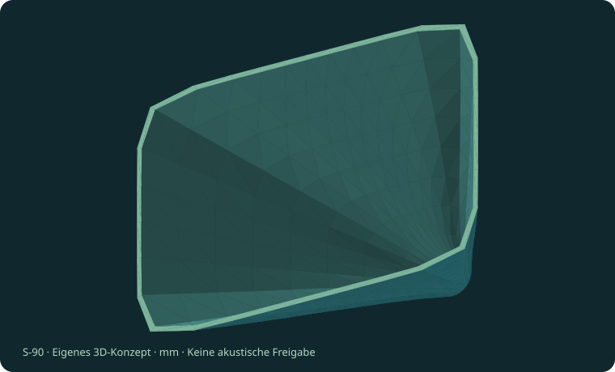

Runder Eintritt mit weichem Übergang auf eine gerundete Rechteckmündung. Referenz für die räumliche Form und für den Vergleich mit Innenkörpern und Zellen.

**Modellmaße:** 300 × 200 × 210 mm. **Treiberbezug:** LaVoce DN10.20-16.

**Band:** ab 1200 Hz nach Herstellerempfehlung; Zielabstrahlung offen

**Formel:** a(t)=r0+(W/2−r0)t; b(t)=r0+(H/2−r0)t; n(t)=2+6t²(3−2t)

**Prüfen:** Mundreflexionen, Halswinkel und reale Strahlbreite benötigen Simulation und Messung.

**Noch offen:** Flansch, Lochkreis und Mund-Rollback fehlen.

[3D-Modell OBJ](../models/single.obj) · [STL mit GitHub-Vorschau](../models/single.stl) · [Interaktiv](designkatalog.html#single) · Quellen: A2, L1

## R-60 · Raketen-Ringkanal

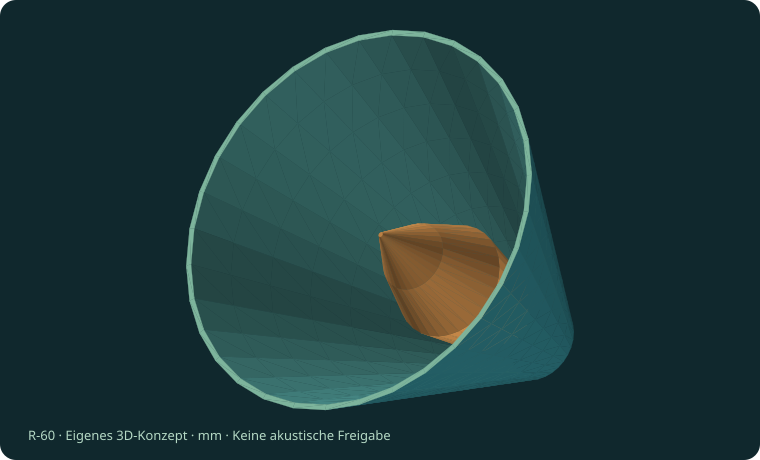

Rotationssymmetrische Hülle mit separatem axialem Innenkörper. Die orange Rakete verdrängt Luftvolumen; der verbleibende Ringquerschnitt ist das eigentliche Schallführungsmaß.

**Modellmaße:** 280 × 280 × 240 mm. **Treiberbezug:** LaVoce DN20.30TK.

**Band:** ab 800 Hz nach Herstellerempfehlung; Ringkanal ungeprüft

**Formel:** S(z)=π[R_a(z)²−R_i(z)²]

**Prüfen:** Engstellen und Reflexionen am Auslauf des Innenkörpers. Die Wege sind nicht phasenoptimiert.

**Noch offen:** Innenkörper ist ein separater Körper ohne Halterung; kein Turbosound-Originalteil.

[3D-Modell OBJ](../models/rocket.obj) · [STL mit GitHub-Vorschau](../models/rocket.stl) · [Interaktiv](designkatalog.html#rocket) · Quellen: T2, L2

## A-90 · Axtkopf-Zweikanal

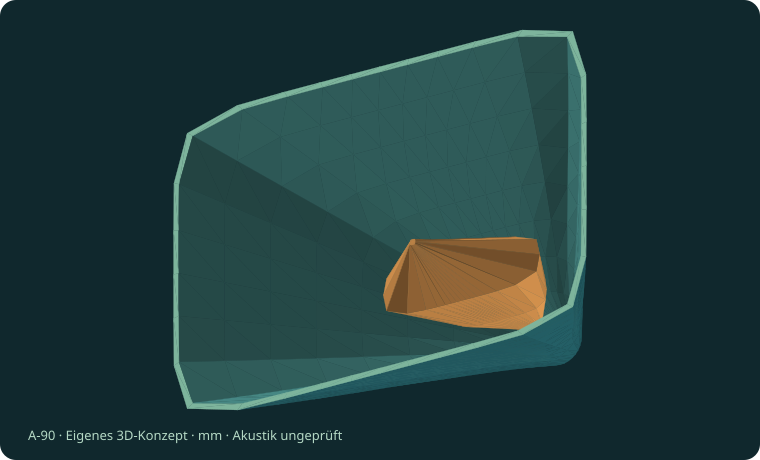

Gerundete Rechteckhülle mit einem abgeflachten, keilförmigen Innenkörper. Der Körper teilt den freien Querschnitt in zwei Hauptwege. Das Modell ist bewusst als eigenständige Formstudie angelegt.

**Modellmaße:** 320 × 220 × 230 mm. **Treiberbezug:** JBL 2426H.

**Band:** Hersteller-Trennung ≥800 Hz, mindestens 12 dB/Okt.; Form ungeprüft

**Formel:** S_frei(z)=S_Hülle(z)−S_Körper(z)

**Prüfen:** Ungleiche Laufwege und Modenkonversion; eine scharfe Schneide garantiert keine gute Übertragung.

**Noch offen:** Befestigung und Treiberflansch fehlen; kein vermessenes Turbosound-Bauteil.

[3D-Modell OBJ](../models/axe.obj) · [STL mit GitHub-Vorschau](../models/axe.stl) · [Interaktiv](designkatalog.html#axe) · Quellen: P2, J1

## M-60 · Multicell 3 × 2

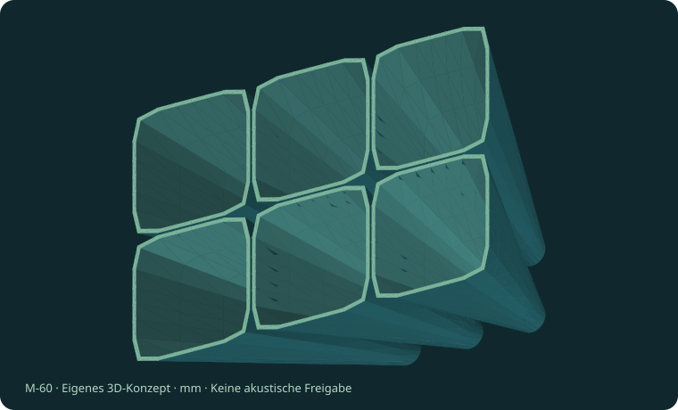

Sechs eigenständige, aufgeweitete Hornzellen in zwei Reihen. Die Zellen besitzen im Modell jeweils einen 18-mm-Eingang. Ihr gemeinsamer Verteiler ist nicht enthalten; sie sind nicht sechs direkt montierbare 2-Zoll-Treiberhörner.

**Modellmaße:** 316 × 208 × 230 mm. **Treiberbezug:** JBL 2446H als Quelle eines noch auszulegenden Verteilers.

**Band:** Projektstart 1000–16000 Hz; keine Abstrahlfreigabe

**Formel:** p_gesamt(θ,φ,f)=Σ p_n(θ,φ,f) exp(jψ_n)

**Prüfen:** Zellinterferenz, Wandkanten und der fehlende Verteilerausgleich bestimmen die reale Abstrahlung.

**Noch offen:** Gemeinsamer Verteiler und 49-mm-Treiberadapter fehlen. Modell enthält sechs getrennte Hohlkörper.

[3D-Modell OBJ](../models/multi.obj) · [STL mit GitHub-Vorschau](../models/multi.stl) · [Interaktiv](designkatalog.html#multi) · Quellen: P1, J2

## P-25 · Polycell mit geschwenkten Zellen

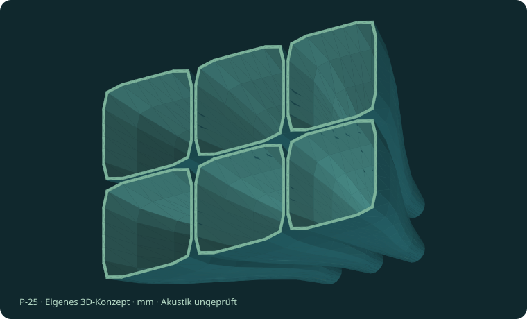

Sechs geschwenkte Kanäle veranschaulichen die räumliche Gestaltung einer gemeinsamen Apertur. Zellachsen und Mundlage sind sichtbar; die Kanalwege sind noch nicht gleichphasig abgestimmt.

**Modellmaße:** 316 × 208 × 250 mm. **Treiberbezug:** LaVoce DN20.30TK über einen noch auszulegenden Verteiler.

**Band:** Projektstart 1600–16000 Hz; Ausgangsphase offen

**Formel:** Zielgröße: Phase Φ(x,y,f) über der gesamten Apertur

**Prüfen:** Gleiche Geometrieabschnitte ergeben bei verschiedenen Achsen keine automatisch gleiche Wellenfront.

**Noch offen:** Verteiler und Laufwegausgleich fehlen. Polycell ist ein Arbeitsbegriff, kein Polyhorn-Nachbau.

[3D-Modell OBJ](../models/poly.obj) · [STL mit GitHub-Vorschau](../models/poly.stl) · [Interaktiv](designkatalog.html#poly) · Quellen: T1, P1, L2

## D-60 · Mehrtreiber-Manifold · Explosionsmodell

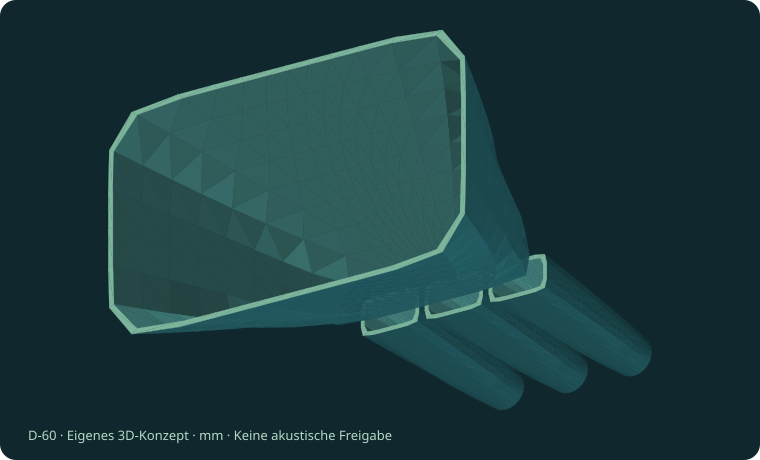

Drei getrennte Eingangskanäle und eine nachgeschaltete gemeinsame Aufweitung. Ein Abstand zwischen den Bauteilen zeigt die Zusammenführung als Explosionsdarstellung. Der offene Zwischenraum ist kein betriebsfähiger akustischer Anschluss.

**Modellmaße:** 300 × 180 × 390 mm. **Treiberbezug:** 3 × JBL 2426H als Konzeptquellen.

**Band:** Projektstart 2000–16000 Hz; gekoppelte Last offen

**Formel:** Z_parallel(f)=Z_Treiber(f)/3 bei identischen Treibern

**Prüfen:** Akustische Rückwirkung, Phasenfehler und elektrische Last; keine Addition von Watt- oder SPL-Angaben.

**Noch offen:** Dichte Zusammenführung, Adapter, Halterungen und Lastabgleich fehlen; vier separate Hohlkörper.

[3D-Modell OBJ](../models/manifold.obj) · [STL mit GitHub-Vorschau](../models/manifold.stl) · [Interaktiv](designkatalog.html#manifold) · Quellen: T2, J1

## C-72 · Runder Konus

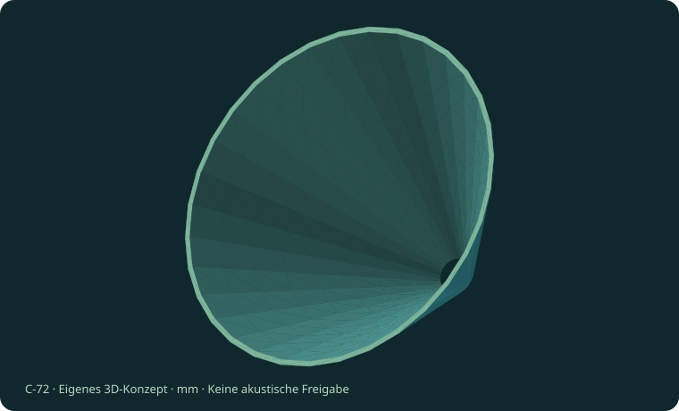

Rotationssymmetrische, geradlinige Kontur als einfachste runde Referenz. Alle Radialschnitte sind identisch. Der geometrische volle Wandwinkel beträgt hier etwa 72,5°; das ist keine gemessene Strahlbreite.

**Modellmaße:** 260 × 260 × 160 mm. **Treiberbezug:** LaVoce DN10.20-16.

**Band:** Treiberempfehlung ab 1200 Hz; Richtkontrollband offen

**Formel:** r(z)=r0+(R_m−r0)z/L; S(z)=πr(z)²

**Prüfen:** Abrupt endender Mund und Quellwellenfront können die Polaren deutlich verändern.

**Noch offen:** Kein Mund-Rollback, keine Befestigung; definierte Modellmaße statt Aperturvorbemessung.

[3D-Modell OBJ](../models/round-conical.obj) · [STL mit GitHub-Vorschau](../models/round-conical.stl) · [Interaktiv](designkatalog.html#round-conical) · Quellen: A1, L1

## O-90 · Rundes OS-Profil

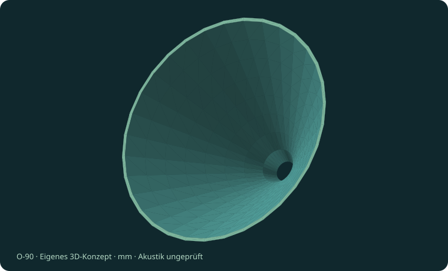

Abgeschnittenes rotationssymmetrisches Oblate-Spheroidal-Profil mit nominellem Halbwinkel 45°. Es zeigt den nichtlinearen Verlauf am Hals im Vergleich zum geraden Konus. Keine OS-SE-Mundterminierung implementiert.

**Modellmaße:** 281.15 × 281.15 × 140 mm. **Treiberbezug:** LaVoce DN10.20-16.

**Band:** Treiberempfehlung ab 1200 Hz; Richtkontrollband offen

**Formel:** r(z)=sqrt[r0²+z² tan²(45°)]

**Prüfen:** Der endliche Mund und die Treiberaustrittswellenfront beeinflussen die tatsächliche Richtwirkung.

**Noch offen:** OS-SE-/R-OSSE-Terminierung und Flansch fehlen. Eigenes Modell nach offen dokumentierter Grundformel.

[3D-Modell OBJ](../models/round-os.obj) · [STL mit GitHub-Vorschau](../models/round-os.stl) · [Interaktiv](designkatalog.html#round-os) · Quellen: A4, L1

## E-32 · Ovaler / elliptischer Waveguide

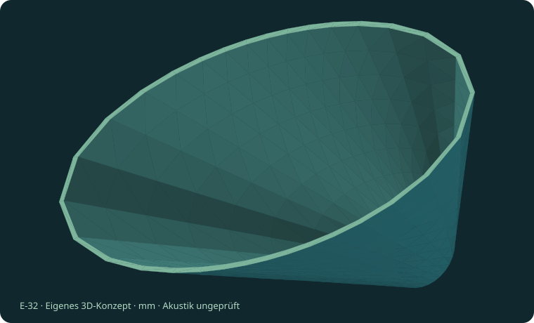

Ein kreisförmiger Hals geht in eine elliptische Mündung mit Seitenverhältnis 2:1 über. Die beiden Hauptachsen wachsen mit derselben Interpolationsfunktion, aber zu unterschiedlichen Endmaßen.

**Modellmaße:** 360 × 180 × 220 mm. **Treiberbezug:** LaVoce DN20.30TK.

**Band:** Treiberempfehlung ab 800 Hz; Zielabstrahlung offen

**Formel:** x=a(z) cosφ; y=b(z) sinφ; S(z)=πa(z)b(z)

**Prüfen:** Ein Seitenverhältnis von 2:1 bedeutet weder halben Winkel noch identische diagonale Polaren.

**Noch offen:** Keine phasengleiche elliptisch-zylindrische Wellenfront nachgewiesen; Flansch und Randverrundung fehlen.

[3D-Modell OBJ](../models/oval.obj) · [STL mit GitHub-Vorschau](../models/oval.stl) · [Interaktiv](designkatalog.html#oval) · Quellen: A2, L2

## Q-36 · Superelliptischer Übergang

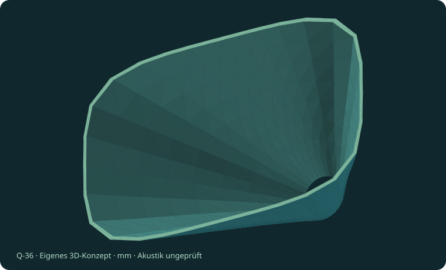

Kontinuierlicher Übergang vom Kreis zu einer gerundeten Rechteckmündung mit Superellipsenexponent 4. So lässt sich die Eckigkeit verändern, ohne abrupt von Kreis auf einen kantigen Querschnitt zu springen.

**Modellmaße:** 360 × 220 × 210 mm. **Treiberbezug:** JBL 2446H.

**Band:** Eigene Projekt-Untergrenze 800 Hz; Herstellerdaten siehe J2/J3

**Formel:** |x/a(z)|^n(z)+|y/b(z)|^n(z)=1; n: 2 → 4

**Prüfen:** Stetige Form allein verhindert keine höheren Moden und garantiert keine konstante Abstrahlung.

**Noch offen:** Eigenes Profil, keine JBL-Image-Control-Replik. Flansch und akustische Optimierung fehlen.

[3D-Modell OBJ](../models/superellipse.obj) · [STL mit GitHub-Vorschau](../models/superellipse.stl) · [Interaktiv](designkatalog.html#superellipse) · Quellen: A2, J2, J4

## W-P · Prismatischer Rechteck-Waveformer

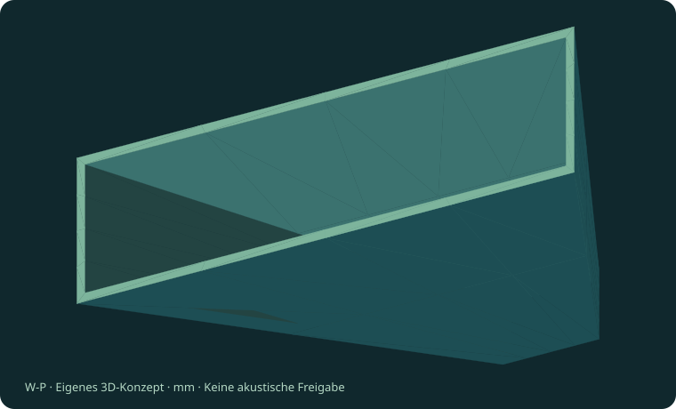

Vier ebene, trapezförmige Wände verbinden einen 40 × 24-mm-Rechteckeingang mit einem 240 × 60-mm-Ausgang. Der abgeflachte Pyramidenstumpf zeigt die prismatische Bauweise besonders deutlich.

**Modellmaße:** 240 × 60 × 180 mm. **Treiberbezug:** LaVoce DN20.30TK mit zusätzlichem Rund-auf-Rechteck-Adapter.

**Band:** Treiberempfehlung ab 800 Hz; Wellenfront nicht validiert

**Formel:** W(z)=40+(240−40)z/L; H(z)=24+(60−24)z/L

**Prüfen:** Eine rechteckige Ebene am Ausgang ist kein Beweis einer ebenen akustischen Wellenfront.

**Noch offen:** Der runde 50-mm-Treiber passt ohne separaten Übergang nicht zum 40 × 24-mm-Eingang. Adapter nicht enthalten.

[3D-Modell OBJ](../models/prism.obj) · [STL mit GitHub-Vorschau](../models/prism.stl) · [Interaktiv](designkatalog.html#prism) · Quellen: P3, P4, L2

## W-S · Rund-auf-Schlitz-Waveformer

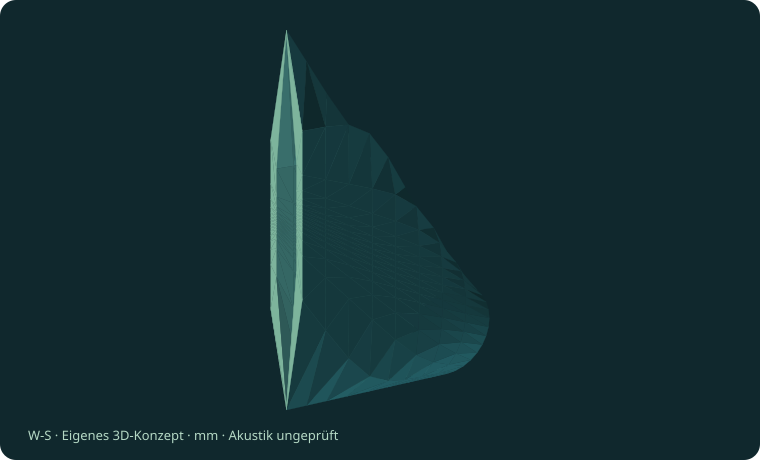

Ein runder Eintritt wird auf einen hohen, schmalen und gerundeten Rechteckschlitz transformiert. Das Modell visualisiert die Geometrieaufgabe eines Line-Array-Vorkopplers. Zusätzliche phasenkorrigierende Kanalführungen sind nicht enthalten.

**Modellmaße:** 14 × 240 × 180 mm. **Treiberbezug:** LaVoce DN20.30TK als runde Eingangsquelle.

**Band:** Treiberempfehlung ab 800 Hz; Ausgangsphase und Nutzband offen

**Formel:** a(t)=25+(7−25)t; b(t)=25+(120−25)t; n(t): 2 → 8

**Prüfen:** Stark unterschiedliche Randwege; der reine Loft ist noch kein isophasischer Line-Array-Koppler.

**Noch offen:** Laufwegausgleich und nachgeschaltetes Abstrahlhorn fehlen; keine plane oder zylindrische Wellenfront nachgewiesen.

[3D-Modell OBJ](../models/round-slot.obj) · [STL mit GitHub-Vorschau](../models/round-slot.stl) · [Interaktiv](designkatalog.html#round-slot) · Quellen: P3, P4, L2
