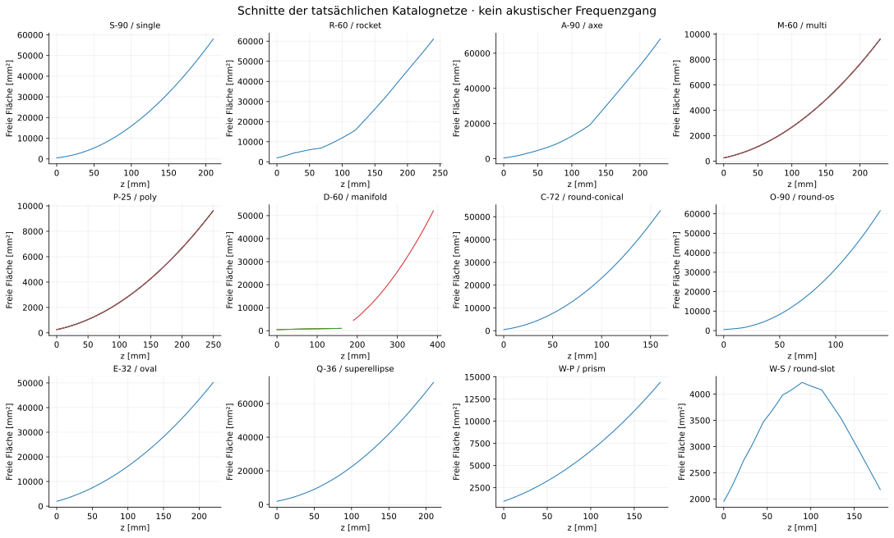
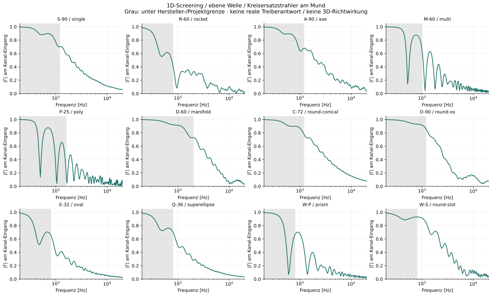
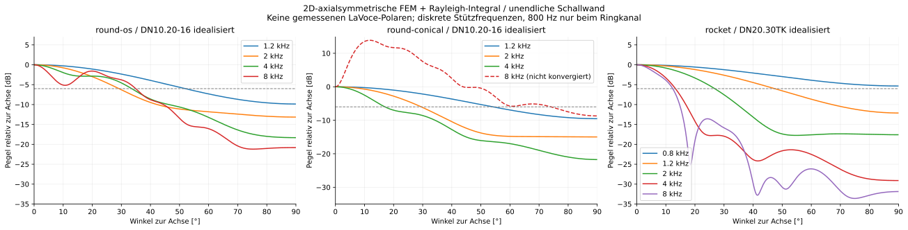
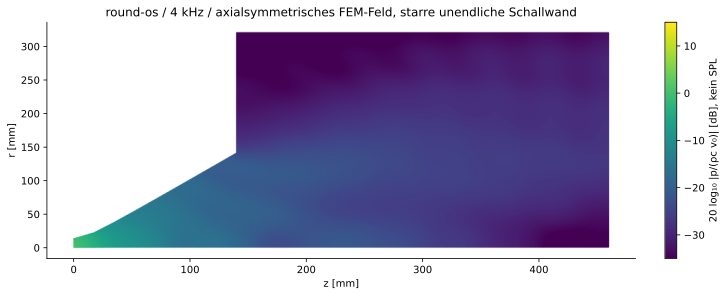
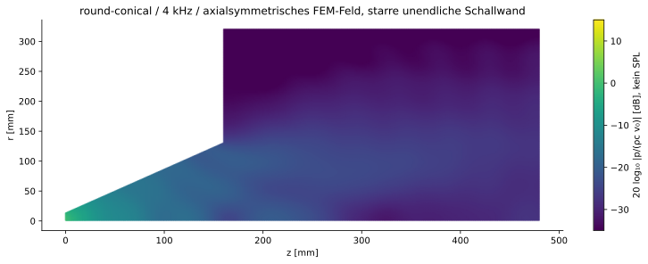
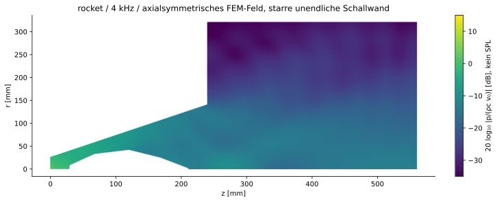

# Theoretische Validierung und Simulation · Kampagne 1.0

**Stand 12.11.2026.** Alle zwölf Katalogkonzepte wurden geometrisch und mit reduzierten akustischen Modellen untersucht. Für Rundkonus, rundes OS-Profil und den Raketen-Ringkanal wurden zusätzlich echte axialsymmetrische FEM-Felder gelöst und daraus Richtdiagramme berechnet. Das ist ein erster numerischer Teilnachweis, keine Validierung kompletter LaVoce-Lautsprecher.

## Wichtigste Ergebnisse

- Multicell, Polycell und Manifold sind im aktuellen CAD kein vollständig an den Treiber angeschlossenes System. Fehlende Verteiler und der 30-mm-Explosionsspalt werden nicht als Luftkanal ersetzt.

- Multicell: **5,73 mm** Differenz der vorhandenen Kanal-Mittellinien; Polycell: **8,00 mm**. Ein gemeinsamer, gleichphasiger Eingang reicht damit geometrisch nicht für identische Wege. Die angegebenen Phasenproxies sind keine FEM-Phasen der Zellen.

- Rechteck-Waveformer: vorhandener Port **960 mm²**, LaVoce DN20.30TK **1963 mm²**. Ein nicht vorhandener Adapter müsste die Fläche auf **48,9 %** reduzieren und die Form umwandeln.

- Rund-auf-Schlitz: der Flächenverlauf verengt sich nach einem Zwischenmaximum zum Ende um **48,4 %**. Der einfache Loft erzeugt keinen nachgewiesenen isophasischen Schlitz.

- Zusätzlich ist die Schlitzmündung zu grob vernetzt: Die CAD-Öffnung besitzt nur **2173 mm²** statt der durch die Superellipse vorgesehenen **3288 mm²**. Das sind **33,9 %** Flächenfehler. Die 1D-Kurven gelten für dieses grobe Netz.

- Das runde OS-Katalogmodell hat nur neun axiale Ringe. Seine lineare Zwischenkontur weicht radial bis **1,77 mm** vom analytischen OS-Profil ab. Die FEM benutzt für den Hauptvergleich genau diese Katalog-Meridiankontur, nicht stillschweigend eine bessere Kurve.

- Die 8-kHz-Konvergenz wird gesondert geprüft. Eine kleine Gleichungsrestnorm oder eine geschlossene Energiebilanz allein beweist keine genaue Richtwirkung.

## 1. Treiber, Quelle und Filter

| Treiber | Hals | Impedanz | Hersteller-Hochpass | Empfindlichkeitsbezug |
|---|---:|---:|---|---|
| LaVoce DN10.20-16 | 25,4 mm | 16 Ω | ≥1200 Hz, ≥12 dB/Okt. | 108 dB bei 2,83 V / 1 m, HD1003 |
| LaVoce DN20.30TK | 50 mm | 8 Ω | ≥800 Hz, ≥12 dB/Okt. | 108 dB bei 2,83 V / 1 m, 60°×40°-Horn |

Belegt durch die aktuellen Hersteller-PDFs: [DN10.20-16](https://www.lavocespeakers.com/wp-admin/admin-post.php?action=lv_generate_pdf&page=4973), [DN20.30TK](https://lavocespeakers.com/wp-admin/admin-post.php?action=lv_generate_pdf&page=4955). Die 2,83-V-Angabe des 16-Ω-Treibers entspricht nur unter der nominal-ohmschen Näherung etwa 0,5 W. Es wurde deshalb kein pauschaler 1-W-/Max-SPL-Wert abgeleitet.

**Simulierte Anregung:** konstante, gleichphasige Halsgeschwindigkeit mit 0,01 m/s Spitzenamplitude; homogene Luft mit c=343 m/s und ρ=1,204 kg/m³. Die Amplitude ist eine frei gewählte lineare Normierung, keine Spannung am LaVoce-Treiber. Die wirkliche Ausgangswellenfront, akustische Quellimpedanz, Membranmechanik und nichtlinearen Verluste sind unbekannt. Die Hersteller-Hochpässe begrenzen die Einsatzdiskussion; sie wurden nicht als vollständiges DSP-/elektrisches Modell in den Feldsolver eingesetzt.

Für zuvor mit JBL referenzierte Konzepte wurden **LaVoce-Alternativen** geprüft: 25-/25,4-mm-Klasse → DN10.20-16, 49-/50-mm- und Mehrzellenklasse → DN20.30TK. Die ursprünglichen Katalogmodelle wurden nicht auf andere Halsmaße umkonstruiert. Nennähnliche Durchmesser oder passende Flächen beweisen keine mechanische Flanschkompatibilität.

## 2. Prüfmatrix aller zwölf Konzepte

| Konzept | LaVoce-Prüfkandidat | Gesamt-Eingangsfläche / Treiberfläche | Befund |
|---|---|---:|---|
| [single](../models/single.stl) | DN10.20-16 | 99,4 % | 1D-Screening; räumlicher Nachweis offen |
| [rocket](../models/rocket.stl) | DN20.30TK | 99,4 % | 2D-Teilnachweis 0,8/1,2/2/4/8 kHz |
| [axe](../models/axe.stl) | DN10.20-16 | 96,3 % | 25,4-mm-LaVoce auf 25-mm-Port: Übergang nötig; Innenkörperhalterung fehlt. |
| [multi](../models/multi.stl) | DN20.30TK | 76,9 % | Gemeinsamer Verteiler fehlt; sechs einzelne 18-mm-Ports sind kein 50-mm-Anschluss. |
| [poly](../models/poly.stl) | DN20.30TK | 76,9 % | Verteiler und Laufwegausgleich fehlen; sechs einzelne 18-mm-Ports. |
| [manifold](../models/manifold.stl) | 3 × DN10.20-16 | 95,8 % | 30-mm-Explosionsspalt und fehlende Zusammenführung; drei 25,4→25-mm-Übergänge fehlen. |
| [round-conical](../models/round-conical.stl) | DN10.20-16 | 99,4 % | 2D-Teilnachweis; 8-kHz-Richtwirkung nicht konvergiert |
| [round-os](../models/round-os.stl) | DN10.20-16 | 99,4 % | 2D-Teilnachweis 1,2/2/4/8 kHz |
| [oval](../models/oval.stl) | DN20.30TK | 99,4 % | 1D-Screening; räumlicher Nachweis offen |
| [superellipse](../models/superellipse.stl) | DN20.30TK | 95,4 % | 50-mm-LaVoce auf 49-mm-Port: glatter Übergang nötig. |
| [prism](../models/prism.stl) | DN20.30TK | 48,9 % | Runder 50-mm-Eingang auf 40 × 24 mm: nicht vorhandener Adapter mit erheblicher Flächenreduktion. |
| [round-slot](../models/round-slot.stl) | DN20.30TK | 99,4 % | 1D-Screening; räumlicher Nachweis offen |

Die Kreisöffnungen der 32-seitigen STL-Polygone besitzen rund 0,64 % weniger Fläche als ein exakter Kreis gleichen Radius. Die 24-seitigen Zellports weichen entsprechend stärker ab. Eine nahezu gleiche Flächenzahl ist daher keine Anpassungsfreigabe. Bei Multicell/Polycell wird über sechs Ports summiert; beim Manifold über die drei Eingänge, ohne den gemeinsamen Ausgang nochmals mitzuzählen.

## 3. Geometrie und Laufwege

| Modell | Vorgesehene lichte Mundfläche [mm²] | Tatsächliche Netzfläche [mm²] | Flächendefizit |
|---|---:|---:|---:|
| single | 58708 | 58093 | 1,0 % |
| rocket | 61575 | 61180 | 0,6 % |
| axe | 68884 | 68181 | 1,0 % |
| multi | 58708 | 57831 | 1,5 % |
| poly | 58708 | 57831 | 1,5 % |
| manifold | 52837 | 52207 | 1,2 % |
| round-conical | 53093 | 52752 | 0,6 % |
| round-os | 62082 | 61684 | 0,6 % |
| oval | 50894 | 50300 | 1,2 % |
| superellipse | 73421 | 72704 | 1,0 % |
| prism | 14400 | 14400 | 0,0 % |
| round-slot | 3288 | 2173 | 33,9 % |

Die freien Luftquerschnitte stammen aus orientierten Ebenenschnitten der **tatsächlich exportierten Dreiecksnetze**. Innenkörperflächen werden abgezogen. Es werden 512 axiale Schnittmitten pro vorhandener Kanalhülle verwendet; Portflächen werden zusätzlich nahe den Endebenen bestimmt. Das prüft keine vollständige Kollisionsfreiheit sämtlicher Bauteile.



| Konzept | Wege der vorhandenen Komponenten [mm] | Wegspreizung Zellen [mm] | geometrischer Phasenproxy am Bandende |
|---|---|---:|---:|
| multi | 237,2, 231,5, 237,2, 237,2, 231,5, 237,2 | 5,73 | 96,3° bei 16 kHz |
| poly | 260,1, 252,1, 260,1, 260,1, 252,1, 260,1 | 8,00 | 134,3° bei 16 kHz |

Die Mittellinienlängen sind Längenintegrale der aus den Schnitten gewonnenen Kanalzentren. Eine solche Geometriedifferenz verursacht nicht zwingend dieselbe akustische Phasendifferenz: Moden, reflektierte Wellen und der fehlende Verteiler fehlen im Wegmodell. Formel des reinen Proxys: Δφ=360° f Δl/c.

Der gerade Randwegproxy am Rechteck-Waveformer beträgt 26,70 mm, am Rund-auf-Schlitz-Waveformer 24,33 mm gegenüber der Achse. Auch dies sind nur Konstruktionswarnungen, keine berechneten Ausgangsphasen.

## 4. Eindimensionale Lastsimulation

Jeder vorhandene Kanal wird in kurze Zylinder mit gemessener Fläche zerlegt. Für gekrümmte Zellmittellinien wird ds/dz berücksichtigt und S_normal≈S_z/(ds/dz) verwendet. Innenkörper erzeugen entsprechend ihren tatsächlichen ebenen Endkappen Querschnittssprünge. Verluste, Querformen und gegenseitige Zellabstrahlung fehlen.

T_j = [[cos(kℓ_j), i Z_j sin(kℓ_j)], [i sin(kℓ_j)/Z_j, cos(kℓ_j)]], Z_j=ρc/S_j. Zeitkonvention exp(+iωt). Aus der Produktmatrix folgen Z_in und U_out/U_in. Die Mundlast ist die analytische Impedanz eines gleichflächigen Kreis-Kolbenstrahlers in einer unendlichen Schallwand. Für rechteckige, ovale und mehrteilige Mündungen ist das ausdrücklich eine grobe Ersatzlast.

Z_L=(ρc/S)[1−2J₁(x)/x+i2H₁(x)/x], x=2ka. Die Schallleistungsidentität des verlustfreien Modells wird geprüft: T_power=1−|Γ|². Γ bezieht sich auf eine ebene, rein reelle Referenzlast ρc/S am vorhandenen Port, **nicht auf einen gemessenen LaVoce-Treiber**.



**Gültigkeitsgrenze:** Die 1D-Kurven dienen dem Lastscreening. Die großen Mündungen erlauben im Nutzband Querformen; oberhalb ihres Cut-ons ersetzt das Modell keine räumliche Rechnung. Auch der erste nicht-axialsymmetrische Halsmodus eines starren Rundkanals liegt bei ungefähr 7,9 kHz für 25,4 mm und 4,0 kHz für 50 mm. Ob ein realer Treiber solche Moden anregt, hängt von seiner unbekannten Ausgangswellenfront ab. Der axialsymmetrische Solver enthält nur m=0.

Der gezeichnete 1D-Frequenzverlauf gehört jeweils zur **ersten vorhandenen Komponente**: bei Multicell/Polycell zur äußeren Einzelzelle, beim Manifold zum ersten Eingangskanal. Er ist keine Übertragungsfunktion des fehlenden Gesamtsystems. Alle übrigen vorhandenen Komponenten wurden zusätzlich an Stützfrequenzen gerechnet. Rohdaten: [one_d_spectra.csv](one_d_spectra.csv), [component_probes.csv](component_probes.csv), [section_profiles.csv](section_profiles.csv).

| 1D-Konvergenz | Segmentzahlen | max. komplexe Änderung von Γ |
|---|---|---:|
| single | 512 → 1024 | 0,00543 |
| rocket | 512 → 1024 | 0,00618 |
| round-os | 512 → 1024 | 0,00378 |
| round-slot | 512 → 1024 | 0,00163 |

## 5. Räumliche Simulation: Rundkonus, OS und Ringkanal

Eigenständiger P1-FEM-Solver für die axialsymmetrische Helmholtzgleichung: ∂r(r∂r p)+∂z(r∂z p)+k²rp=0. Die schwache Form verwendet die echte Gewichtung 2πr; Steifigkeit und gewichtete lineare Massenmatrix werden elementweise integriert. Rigidität gilt an Hornwand, Achse und unendlicher Mund-Schallwand. Der Außenraum ist radial und axial auf 0,32 m begrenzt.

An der Außenbegrenzung gilt eine winkelabhängige auslaufende sphärische Robin-Näherung ∂n p=−(ik+1/R)(n·R̂)p. Das ist **keine PML und keine exakte Fernfeldrandbedingung**. Die Abhängigkeit von der Begrenzung wurde mit 0,45 m Gegenraum getestet. Schallabstrahlung nach hinten und ein frei stehendes Gehäuse sind nicht modelliert.

Die komplexe Mundgeschwindigkeit stammt aus der schwachen FEM-Reaktion an der Horn-/Außenraum-Schnittstelle. Das Rayleigh-Fernfeldintegral enthält diese räumlich veränderliche Amplitude und Phase. Es setzt keine gleichphasige Apertur voraus. Die 32-eckigen CAD-Ringe werden in der axialsymmetrischen Rechnung als Kreise behandelt, ihre neun axialen Radien und die lineare Zwischenkontur bleiben erhalten.



| Modell | Frequenz | berechnete volle −6-dB-Breite | Re(Zin)/(ρc/S) | Im(Zin)/(ρc/S) |
|---|---:|---:|---:|---:|
| round-os | 1.2 kHz | 103,9° | 0,151 | 0,499 |
| round-os | 2 kHz | 58,3° | 0,454 | 0,702 |
| round-os | 4 kHz | 67,1° | 0,971 | 0,329 |
| round-os | 8 kHz | 69,9° | 0,964 | 0,301 |
| round-conical | 1.2 kHz | 108,3° | 0,177 | 0,428 |
| round-conical | 2 kHz | 59,0° | 0,376 | 0,563 |
| round-conical | 4 kHz | 34,0° | 0,747 | 0,467 |
| round-conical | 8 kHz | nicht konvergiert; Diagnosewert 148,2° | 1,031 | 0,308 |
| rocket | 0.8 kHz | keine Kreuzung bis ±90° | 0,924 | 0,799 |
| rocket | 1.2 kHz | 94,8° | 0,509 | 0,192 |
| rocket | 2 kHz | 53,6° | 0,693 | 0,379 |
| rocket | 4 kHz | 26,6° | 0,938 | 0,244 |
| rocket | 8 kHz | 24,7° | 1,041 | -0,072 |

Die Breite ist die erste −6-dB-Kreuzung relativ zur Achse, vom Achsstrahl aus nach außen gesucht. Bei Einbrüchen auf Achse oder mehreren Keulen kann diese Kennzahl irreführend sein. H und V sind nur wegen der angenommenen Rotationssymmetrie gleich. Vier Stützfrequenzen bei Konus/OS und fünf beim Ringkanal beweisen keine durchgehende Bandabdeckung oder konstante Abstrahlung.







Beim Ringkanal ist der vorhandene Innenkörper als starrer Körper mit geschlossener Vorder- und Endkappe aus dem Luftgebiet ausgespart. Seine Halterung fehlt; deren akustische Störung ist nicht simuliert.

## 6. Numerische Verifikation und offene Konvergenz

Die größte relative Energiebilanzabweichung der Horn-FEM-Läufe beträgt 2.83e-14; die größte relative Gleichungsrestnorm 8.62e-12. Diese Größen prüfen die diskrete Lösung, nicht deren Annäherung an den realen Lautsprecher.

| Modell / Gegenprüfung | Frequenz | ΔZ normiert | ΔBreite | max. Pegeldifferenz, beide Kurven >−20 dB |
|---|---:|---:|---:|---:|
| round-os: h=3 mm vs 1.75 mm | 1.2 kHz | 0,0010 | 0,01° | 0,00 dB |
| round-os: h=3 mm vs 1.75 mm | 2 kHz | 0,0022 | 0,01° | 0,01 dB |
| round-os: h=3 mm vs 1.75 mm | 4 kHz | 0,0042 | 0,55° | 0,15 dB |
| round-os: h=3 mm vs 1.75 mm | 8 kHz | 0,0280 | 0,27° | 1,13 dB |
| round-os: h=1.75 mm vs 1.25 mm | 8 kHz | 0,0047 | 0,09° | 0,40 dB |
| round-os: extent=0.32 m vs 0.45 m | 8 kHz | 0,0060 | 0,13° | 0,10 dB |
| round-conical: h=3 mm vs 1.75 mm | 1.2 kHz | 0,0012 | 0,03° | 0,00 dB |
| round-conical: h=3 mm vs 1.75 mm | 2 kHz | 0,0020 | 0,00° | 0,01 dB |
| round-conical: h=3 mm vs 1.75 mm | 4 kHz | 0,0057 | 0,00° | 0,07 dB |
| round-conical: h=3 mm vs 1.75 mm | 8 kHz | 0,0099 | 42,12° | 4,41 dB |
| round-conical: h=1.75 mm vs 1.25 mm | 8 kHz | 0,0009 | 11,76° | 1,54 dB |
| round-conical: extent=0.32 m vs 0.45 m | 8 kHz | 0,0046 | 1,95° | 0,31 dB |
| rocket: h=3 mm vs 1.75 mm | 0.8 kHz | 0,0012 | offen | 0,00 dB |
| rocket: h=3 mm vs 1.75 mm | 1.2 kHz | 0,0011 | 0,03° | 0,00 dB |
| rocket: h=3 mm vs 1.75 mm | 2 kHz | 0,0013 | 0,02° | 0,02 dB |
| rocket: h=3 mm vs 1.75 mm | 4 kHz | 0,0016 | 0,01° | 0,02 dB |
| rocket: h=3 mm vs 1.75 mm | 8 kHz | 0,0052 | 0,00° | 0,88 dB |
| rocket: h=1.75 mm vs 1.25 mm | 8 kHz | 0,0018 | 0,00° | 0,21 dB |
| rocket: extent=0.32 m vs 0.45 m | 8 kHz | 0,0006 | 0,02° | 0,05 dB |

Projektkriterium für den 8-kHz-Teilnachweis: Änderung der Breite <2°, |ΔZ_norm|<0,03 und Polardifferenz <2 dB, wo beide Kurven über −20 dB liegen, im feinsten Netzvergleich. Die Grenzwerte sind projektinterne Akzeptanzkriterien, keine Norm. Ein verfehltes Kriterium bleibt als offen gekennzeichnet.

**Unabhängiger Benchmark:** Ein Kolbenstrahler ohne Horn mit Radius 12,7 mm in derselben Schallwand wurde mit seiner analytischen Strahlungsimpedanz verglichen. Die verbleibende Abweichung umfasst Randtrunkierung und FEM-Diskretisierung.

| Frequenz | relativer Impedanzfehler h=3 mm | relativer Impedanzfehler h=1,75 mm |
|---|---:|---:|
| 1.2 kHz | 2,30 % | 1,02 % |
| 2 kHz | 2,39 % | 1,06 % |
| 4 kHz | 2,69 % | 1,18 % |
| 8 kHz | 2,87 % | 1,30 % |

### OS: CAD-Facettierung gegen analytische Kontur

| Frequenz | −6-dB-Breite Katalogmeridian | −6-dB-Breite analytischer Meridian | ΔZ_norm Betrag |
|---|---:|---:|---:|
| 1.2 kHz | 103,9° | 103,9° | 0,041 |
| 2 kHz | 58,3° | 58,3° | 0,098 |
| 4 kHz | 67,1° | 67,0° | 0,308 |
| 8 kHz | 69,9° | 69,8° | 0,278 |

Die analytische Variante ist eine Sensitivitätsstudie bei h=1,75 mm, nicht ein fertig freigegebenes neues CAD-Modell. Sie zeigt, warum ein nominaler Profilname allein keine genaue Geometrie festlegt.

## 7. Konsequenzen für die nächsten Revisionen

1. Rundes OS-Profil als ersten DN10.20-16-Prototyp weiterführen: Hals-/Mundkontur fein auflösen, Treiberflansch ergänzen, Mundterminierung optimieren und danach mit realer Quelle erneut rechnen. Die aktuelle Form liefert keinen Nachweis von 90° über 1,2–18 kHz.

2. Rundkonus bei 8 kHz weiter verfeinern und Keulen/On-axis-Einbrüche untersuchen. Einen instabilen −6-dB-Wert nicht als Produktabstrahlung übernehmen.

3. Für DN20.30TK zuerst den ovalen Einzel-Waveguide in 3D untersuchen. Die 1D-Ersatzlast erlaubt derzeit keine Aussage über H-/V-/Diagonalpolaren.

4. Multicell/Polycell: gemeinsamen Verteiler und Laufwegausgleich konstruieren, danach alle Zellen einschließlich gegenseitiger Kopplung in einem 3D-Modell lösen.

5. Schlitzmündung zuerst mit einer an die starke Exzentrizität angepassten Umfangsvernetzung neu erstellen. Rechteck- und Schlitz-Waveformer benötigen außerdem ein echtes Phasenkorrekturkonzept und einen belegten Treiberübergang. Eine reine Querschnittsumformung reicht nicht als Funktionsnachweis.

6. Manifold erst nach einer dichten, vollständigen CAD-Verbindung als System simulieren. Kein Schließen des Explosionsspalts durch eine unbelegte Rechenannahme.

## 8. Reproduzieren und Daten

```sh
python -m pip install -r validation/requirements.txt
OPENBLAS_NUM_THREADS=1 MPLCONFIGDIR=/tmp/speaker-mpl python validation/run.py
python tests/acoustics_test.py
python scripts/build.py
```

[Rechenparameter, Versionen und SHA-256-Eingangshashes](manifest.json) · [Maschinenlesbare Ergebnisse](results.json) · [FEM-Polaren CSV](fem_polars.csv) · [Mundgeschwindigkeit CSV](fem_mouth_velocity.csv). Der vollständige Schallfeldvektor wird reproduzierbar neu berechnet, nicht als großes Binärarchiv gespeichert.

Einheiten: Meter, Quadratmeter, Sekunden, Hertz; p/U in Pa·s/m³. Alle Amplituden sind Spitzenwert-Zeiger. Positive Energie geht in die Luft. Angegebene Quellenphase ist einheitlich; ein elektrisches Hochpass-, Verstärker- oder Schutzlimiter-Modell fehlt.

## Quellen und Reichweite

[LaVoce DN10.20-16 PDF](https://www.lavocespeakers.com/wp-admin/admin-post.php?action=lv_generate_pdf&page=4973) · [LaVoce DN20.30TK PDF](https://lavocespeakers.com/wp-admin/admin-post.php?action=lv_generate_pdf&page=4955) · [COMSOL: analytische Kolbenstrahlerreferenz und Rayleigh-Integral](https://doc.comsol.com/6.3/doc/com.comsol.help.models.aco.baffled_piston_radiation/models.aco.baffled_piston_radiation.pdf) · [Webster-Grundlage](https://pmc.ncbi.nlm.nih.gov/articles/PMC1091593/) · [OS-Profilformel](https://at-horns.eu/release/OS-SE%20Waveguide.pdf). Die eigene Simulation wurde mit NumPy/SciPy ausgeführt; es wurde keine COMSOL-, AKABAK- oder ABEC-Rechnung behauptet.

**Nicht untersucht:** vollständige 3D-Polaren nicht rotationssymmetrischer Modelle, reale elektrische Impedanz oder Spannung/SPL-Übertragung der Treiber, interner Phaseplug, Membranbelastung, thermische Kompression, Klirr, Grenzpegel, Fertigungstoleranzen, tragende Konstruktion und messtechnische Bestätigung. Kein Konzept erhält durch diese erste Kampagne eine Produkt- oder Leistungsfreigabe.
